<!-- Artwork is generated: `npm install && npm run build`. Stats redraw daily via .github/workflows/profile-stats.yml. -->

<a href="https://rayhanson.tech/">
  
</a>

  
  
  
  
   
  
  
  
  

 

<picture>
  <source media="(prefers-color-scheme: light)" srcset="assets/headers/about-light.svg" />
  
</picture>

I was the kid with a screwdriver in his pocket, taking things apart to see what was inside. Not much has changed. I don’t trust anything until I’ve opened it up and figured out exactly how it works.

Gaming pulled me into graphic design, then interactive work, photography, video editing, and content on **[RayBits Gaming](https://youtube.com/@RayBitsGaming)**. Today I engineer **AI systems and automation**, and I own them end to end: the architecture, the code, and the call on when they’re ready. **Enigma MCP**, a Rust memory server with 25 tools and 512 tests, is the latest proof.

I’m a designer as much as an engineer. I still design, record, and edit, and I hold all of it to the same standard. The goal hasn’t changed: technology that fits into everyday life, cuts the busywork, and leaves room for what matters.

**Right now:** engineering **Enigma MCP**, shipping **Stanza**, building out **JimBro**, and breaking into **cybersecurity**.

**Ask me about:** MCP servers and multi-agent architecture · hybrid retrieval, RAG, and knowledge graphs · taking a product from wireframe to live app · webcam gestures, shaders, Resolve, Audition, and OBS.

<a href="https://rayhanson.tech/#about"><picture><source media="(max-width: 600px)" srcset="assets/principle-narrow.svg" /></picture></a>

 

<picture>
  <source media="(prefers-color-scheme: light)" srcset="assets/headers/work-light.svg" />
  
</picture>

  <a href="https://rayhanson.tech/projects/enigma/"><picture><source media="(max-width: 600px)" srcset="assets/cards/enigma.svg" width="100%" /></picture><picture><source media="(max-width: 600px)" srcset="assets/spacer.svg" width="0" /></picture></a><a href="https://rayhanson.tech/projects/stanza/"><picture><source media="(max-width: 600px)" srcset="assets/cards/stanza.svg" width="100%" /></picture></a>
  <a href="https://rayhanson.tech/projects/jimbro/"><picture><source media="(max-width: 600px)" srcset="assets/cards/jimbro.svg" width="100%" /></picture><picture><source media="(max-width: 600px)" srcset="assets/spacer.svg" width="0" /></picture></a><a href="https://virtual-theremin.rayhanson.tech/"><picture><source media="(max-width: 600px)" srcset="assets/cards/theremin.svg" width="100%" /></picture></a>

<a href="https://github.com/Rayhanson-Git/enigma">Enigma on GitHub</a> · <a href="https://github.com/Rayhanson-Git/stanza">Stanza on GitHub</a> · <a href="https://github.com/Rayhanson-Git/stanza/releases/latest">Download Stanza for Mac</a> · <a href="https://jimbro.rayhanson.tech/">Try JimBro</a> · <a href="https://rayhanson.tech/projects/virtual-theremin/">Virtual Theremin case study</a>

 

<picture>
  <source media="(prefers-color-scheme: light)" srcset="assets/headers/more-light.svg" />
  
</picture>

  <a href="https://gesture-particles.rayhanson.tech/"><picture><source media="(max-width: 600px)" srcset="assets/cards/gesture.svg" width="100%" />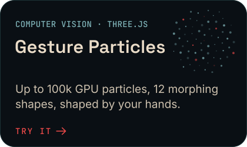</picture><picture><source media="(max-width: 600px)" srcset="assets/spacer.svg" width="0" /></picture></a><a href="https://neon-orbit.rayhanson.tech/"><picture><source media="(max-width: 600px)" srcset="assets/cards/neon.svg" width="100%" />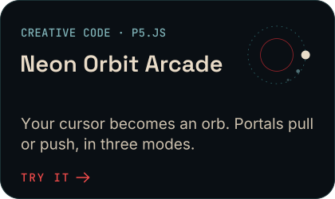</picture><picture><source media="(max-width: 600px)" srcset="assets/spacer.svg" width="0" /></picture></a><a href="https://orbit-playground.rayhanson.tech/"><picture><source media="(max-width: 600px)" srcset="assets/cards/orbit.svg" width="100%" />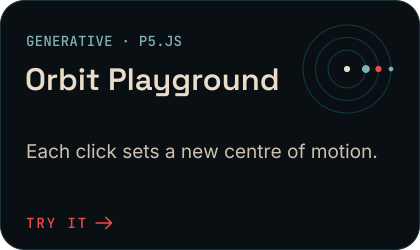</picture></a>
  <a href="https://wasp-dodge.rayhanson.tech/"><picture><source media="(max-width: 600px)" srcset="assets/cards/wasp.svg" width="100%" />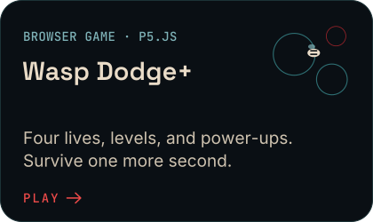</picture><picture><source media="(max-width: 600px)" srcset="assets/spacer.svg" width="0" /></picture></a><a href="https://rayhanson.tech/projects/gymlog/"><picture><source media="(max-width: 600px)" srcset="assets/cards/gymlog.svg" width="100%" /></picture><picture><source media="(max-width: 600px)" srcset="assets/spacer.svg" width="0" /></picture></a><a href="https://leaveby.rayhanson.tech/leaveby"><picture><source media="(max-width: 600px)" srcset="assets/cards/leaveby.svg" width="100%" /></picture></a>
  <a href="https://rayhanson.tech/projects/studio-apartment-evening/"><picture><source media="(max-width: 600px)" srcset="assets/cards/studio.svg" width="100%" />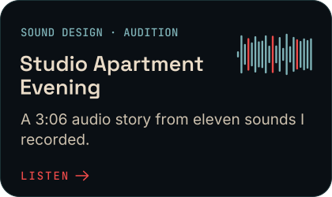</picture><picture><source media="(max-width: 600px)" srcset="assets/spacer.svg" width="0" /></picture></a><a href="https://rayhanson.tech/projects/devil-may-cry-music-video/"><picture><source media="(max-width: 600px)" srcset="assets/cards/dmc.svg" width="100%" />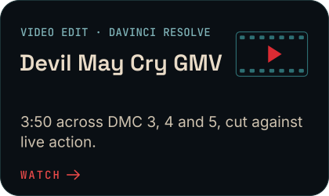</picture><picture><source media="(max-width: 600px)" srcset="assets/spacer.svg" width="0" /></picture></a><a href="https://github.com/DeepExtrema/tesseract/pull/21"><picture><source media="(max-width: 600px)" srcset="assets/cards/tesseract.svg" width="100%" /></picture></a>

 

<picture>
  <source media="(prefers-color-scheme: light)" srcset="assets/headers/toolkit-light.svg" />
  
</picture>

<a href="https://rayhanson.tech/#about"><picture><source media="(max-width: 600px)" srcset="assets/toolkit-narrow.svg" /></picture></a>

 

<picture>
  <source media="(prefers-color-scheme: light)" srcset="assets/headers/activity-light.svg" />
  
</picture>

 

<picture>
  <source media="(prefers-color-scheme: light)" srcset="assets/headers/support-light.svg" />
  
</picture>

If something I made helped you, or you just want to see more of it, you can chip in here. Every coffee goes into new projects and videos.

  
  &nbsp;
  

 

<a href="https://rayhanson.tech/">
  
</a>
