<!-- Artwork is generated: `npm install && npm run build`. Stats redraw daily via .github/workflows/profile-stats.yml. -->

  
  
  
  
   
  
  
  
  

 

<picture>
  <source media="(prefers-color-scheme: light)" srcset="assets/headers/about-light.svg" />
  
</picture>

I was the kid with a screwdriver in his pocket, taking things apart to see what was inside. Not much has changed. I don’t trust anything until I’ve opened it up and figured out exactly how it works.

Gaming pulled me into graphic design, then interactive work, photography, video editing, and content on **[RayBits Gaming](https://youtube.com/@RayBitsGaming)**. Today I engineer **AI systems and automation**, and I own them end to end: the architecture, the code, and the call on when they’re ready. **Enigma MCP**, a Rust memory server with 25 tools and 512 tests, is the latest proof.

I’m a designer as much as an engineer. I still design, record, and edit, and I hold all of it to the same standard. The goal hasn’t changed: technology that fits into everyday life, cuts the busywork, and leaves room for what matters.

<table>
  <tr>
    <td width="50%" valign="top">

**Right now**

- Engineering **Enigma MCP**, a Rust memory server for AI agents
- Shipping **Stanza**, word-by-word lyrics for the Mac
- Building out **JimBro**, my local-first gym companion
- Breaking into **cybersecurity**

</td>
    <td width="50%" valign="top">

**Ask me about**

- Designing MCP servers and multi-agent architecture
- Hybrid retrieval, RAG, and knowledge graphs
- Taking a product from wireframe to live app
- Webcam gestures, shaders, Resolve, Audition, and OBS

</td>
  </tr>
</table>

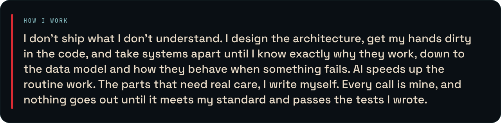

 

<picture>
  <source media="(prefers-color-scheme: light)" srcset="assets/headers/work-light.svg" />
  
</picture>

  <a href="https://rayhanson.tech/projects/enigma/"></a>
  <a href="https://rayhanson.tech/projects/stanza/"></a>
  
  

<a href="https://github.com/Rayhanson-Git/enigma">Enigma on GitHub</a> · <a href="https://github.com/Rayhanson-Git/stanza">Stanza on GitHub</a> · <a href="https://github.com/Rayhanson-Git/stanza/releases/latest">Download Stanza for Mac</a> · <a href="https://jimbro.rayhanson.tech/">Try JimBro</a>

<picture>
  <source media="(prefers-color-scheme: light)" srcset="assets/headers/more-light.svg" />
  
</picture>

  
  
  
  
  <a href="https://rayhanson.tech/projects/gymlog/"></a>
  <a href="https://leaveby.rayhanson.tech/leaveby">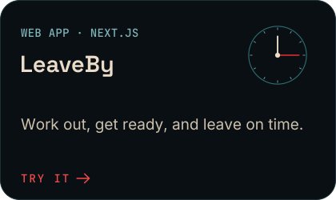</a>
  
  
  <a href="https://github.com/DeepExtrema/tesseract/pull/21">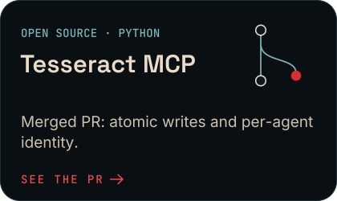</a>

<picture>
  <source media="(prefers-color-scheme: light)" srcset="assets/headers/toolkit-light.svg" />
  
</picture>

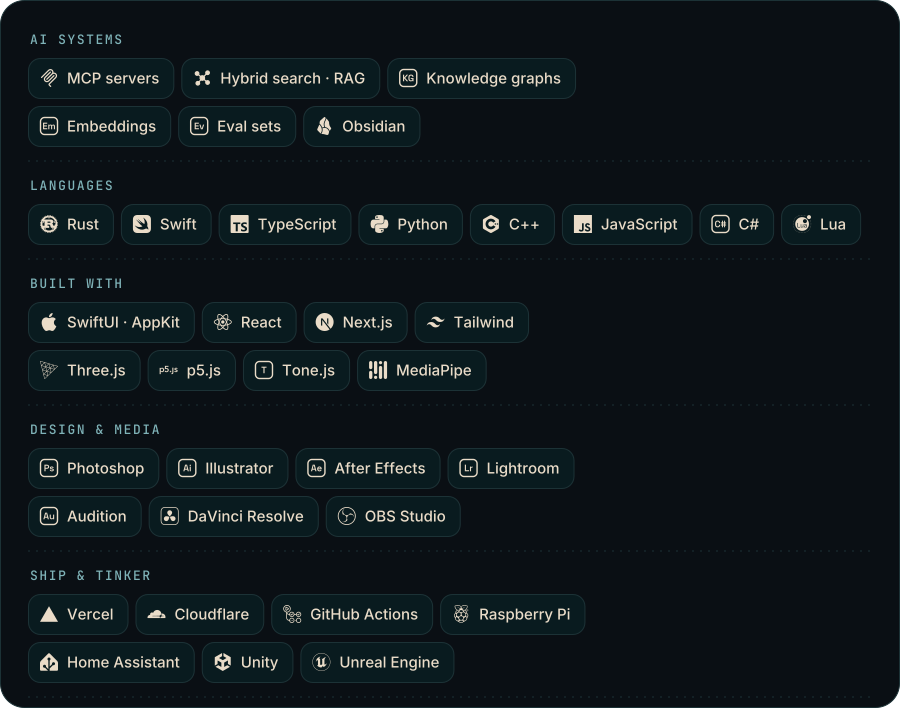

 

<picture>
  <source media="(prefers-color-scheme: light)" srcset="assets/headers/activity-light.svg" />
  
</picture>

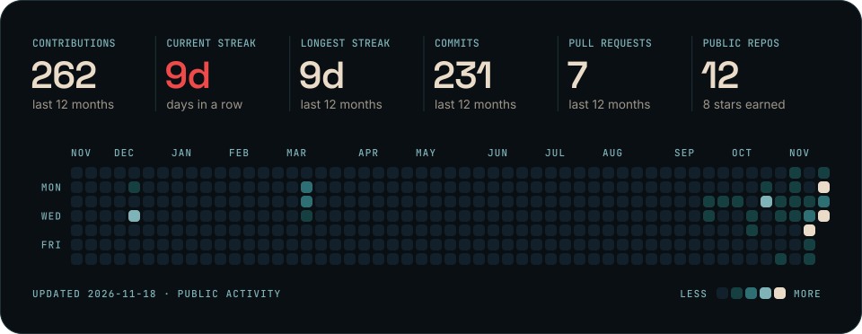
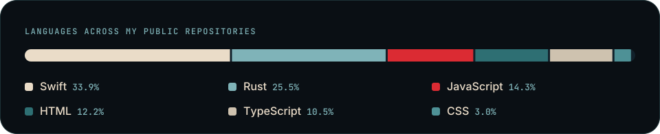

 

<picture>
  <source media="(prefers-color-scheme: light)" srcset="assets/headers/support-light.svg" />
  
</picture>

If something I made helped you, or you just want to see more of it, you can chip in here. Every coffee goes into new projects and videos.

  
  &nbsp;
  

 

